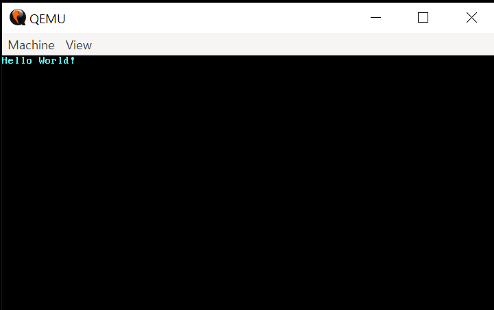

# A Minimal Rust Kernel

## The Boot Process

전원이 켜졌을 때 컴퓨터는 젤 먼저 마더보드의 롬(ROM)에 저장된 펌웨어 코드를 실행한다. 이 코드는 power-on self test를 진행하고, 사용 가능한 램(RAM)을 확인하며, CPU 및 하드웨어의 초기화 작업을 진행한다. 그 후 부팅 가능한 디스크를 탐지하고 운영체제 거널을 부팅하기 시작한다.

x86 시스템에는 BIOS(Basic Input/Output System)와 UEFI(Unified Extensible Firmware Interface) 이렇게 두 가지 펌웨어 표준이 존재한다. BIOS가 더 오래됐지만 간단하게 구현할 수 있고 반대로 UEFI는 신식 표준이며 더 많은 기능들을 가췄다.

최소한의 기능을 갖춘 커널을 만들기 위해선 BIOS로도 충분하기에 BIOS 부팅을 준비해보자.

## BIOS Boot

UEFI 표준으로 동작하는 최신 기기도 BIOS를 지원하기에 존재하는 거의 모든 x86 시스템들이 BIOS를 지원한다. 이 점이 장점이자 단점인데, 1980년대의 구식 부트로더들에 대한 하위 호환성을 유지하기 위해 부팅 전에 항상 CPU를 16비트 호환모드(real mode)로 설정해야 한다. 

컴퓨터 전원이 켜지면 컴퓨터는 마더보드의 특별한 플래시 메모리로부터 BIOS 이미지를 로드한다. BIOS 이미지는 자가 점검 및 하드웨어 초기화 작업을 처리한 후에 부팅 가능한 디스크가 있는지 탐색한다. 
부팅 가능한 디스크를 발견하면 제어 흐름은 해당 디스크의 부트로더에게 넘겨진다. 이 부트로더는 디스크의 가장 앞 주소 영역에 저장되는 512 바이트 크기의 시행 파일이다. 대부분의 부트로더들의 경우 로직을 저장하는 데에 512 바이트보다 더 큰 용량이 필요하다. 그렇기에 부트로더의 로직을 둘로 쪼개어 첫번째 단계 로직을 처음 512 바이트 안에 담고, 두번째 단계 로직은 첫번째 단계 로직에 의해 로드된 이후 실행된다. 

부트로더는 디스크의 저장된 커널 이미지 주소를 찾고, 메모리에 커널 이미지를 로드한다. 그 다음 CPU를 16비트 real mode에서 32비트 protected mode로 전환하고, 그 후에 다시 CPU를 64비트 long mode로 전환한 이후부터 64비트 레지스터 및 메인 메모리의 모든 주소를 사용할 수 있게 된다. 여기서 리얼 모드, 보호 모드, 롱 모드 모두 x86 호환 CPU의 운영 방식이다. 

그 다음 BIOS로부터 메모리 매핑 정보 등의 필요한 정보를 알아내 운영체제에 전달한다. 


## A Minimal Kernel

컴퓨터의 부팅 과정에 대해 간단하게 알아봤으니 이제 스스로 최소한의 기능을 갖춘 운영체제 커널을 작성해보자. 모든 프로그래밍의 시작, Hello World!를 출력해보자. Rust는 nightly 채널을 설치해야 한다. 

### Target Specification

Cargo는 `--target` 인자를 통해 여러 컴파일 대상 시스템을 지원한다. 컴파일 대상은 소위 target triple을 통해 표현되는데, CPU 아키텍쳐와 CPU 공급 업체, 운영체제, 그리고 API를 파악할 수 있다. 
예를 들어 `x86_64-unknown-linux-gnu`는 `x86_64` CPU, 임의의 CPU 공급 업체, Linux 운영체제, 그리고 GNU API를 갖춘 시스템으 나타낸다. 
우리의 목표 컴파일 대상 환경(운영체제가 따로 없는 환경)을 정의하려면 몇 가지 특별한 설정 인자들을 사용해야 하기에 우리가 사용할 수 있는 target triple은 없다. 
json 파일을 통해 타겟을 지정할 수 있다. 


`x86_64-riir_os.json`

```json
{
  "llvm-target": "x86_64-unknown-none",
  "data-layout": "e-m:e-p270:32:32-p271:32:32-p272:64:64-i64:64-i128:128-f80:128-n8:16:32:64-S128", // 다양한 정수, 부동소수점 표기 소수, 포인터 등의 메모리 상 실제 크기 등을 지정
  "arch": "x86_64",
  "target-endian": "little",
  "target-pointer-width": 64,
  "target-c-int-width": 32,
  "os": "none", // 우리 os는 bare metal 환경에서 동작하 것이기에 llvm-target 필드의 os값과 os 값은 none이다. 
  "executables": true,
  "linker-flavor": "ld.lld",
  "linker": "rust-lld",
  "panic-strategy": "abort", // 패닉 시 스택 되감기를 지원하지 않기에, 이 설정으로 패닉 시 프로그램 즉시 종료 설정.
  "disable-redzone": true,
  "features": "-mmx,-sse,+soft-float",
  "rustc-abi": "x86-softfloat"
}

```

### Building our Kernel

```rs
// src/main.rs

#![no_std] // Rust 표준 라이브러리를 링크하지 않도록 합니다
#![no_main] // Rust 언어에서 사용하는 실행 시작 지점 (main 함수)을 사용하지 않습니다

use core::panic::PanicInfo;

/// 패닉이 일어날 경우, 이 함수가 호출됩니다.
#[panic_handler]
fn panic(_info: &PanicInfo) -> ! {
    loop {}
}

#[unsafe(no_mangle)] // 이 함수의 이름을 mangle하지 않습니다
pub extern "C" fn _start() -> ! {
    // 링커는 기본적으로 '_start' 라는 이름을 가진 함수를 실행 시작 지점으로 삼기에,
    // 이 함수는 실행 시작 지점이 됩니다
    loop {}
}
```


`x86_64-riir_os.json` 을 활용하여 cargo build를 하면 아래와 같은 에러가 발생한다.  `cargo build --target x86_64-riir_os.json`


```text
error[E0463]: can't find crate for `core`
  |
  = note: the `x86_64-riir_os` target may not be installed
  = help: consider downloading the target with `rustup target add x86_64-riir_os`
  = help: consider building the standard library from source with `cargo build -Zbuild-std`

For more information about this error, try `rustc --explain E0463`.
```

rust 컴파일러가 core 라이브러리를 찾지 못해 실패한다. `no_std`를 사용했기 때문이다. `core` 라이브러리는 미리 컴파일된 상태이 라이브러리로 rust 컴파일러와 함께 배포된다. 일반적인 상황에서는 문제가 되지 않지만, 우리가 정의한 커스텀 환경을 위해 빌드하는 경우에는 라이브러리를 이용할 수 없다. 기본적으로 지원되지 않는 새로운 시스템 환경을 위해 코드를 빌드하기 위해서는 새로운 시스템 환경에서 구동 가능하도록 `core` 라이브러리를 새롭게 빌드해야 한다.

#### build-std option

cargo의 [build-std](https://doc.rust-lang.org/nightly/cargo/reference/unstable.html#build-std) 기능이 필요한 시점이다. (nightly에만 있는 기능이다) 

`.cargo/config.toml`에 아래와 같이 코드를 추가하여 사용할 수 있다.

```toml
# .cargo/config.toml 에 들어갈 내용

[unstable]
build-std = ["core", "compiler_builtins"]
```

위 설정은 cargo에게 `core`와 `compiler_builtins` 라이브러리를 새로 컴파일하도록 지시한다. `compiler_builtins`는 `core`가 사용하는 라이브러리다. 해당 라이브러리들의 소스 코드가 있어야 새로 컴파일할 수 있기에, `rustup component add rust-src` 명령어를 통해 소스 코드를 설치해야 한다. 

이제 다시 build 해보면 예쁘게 성공한다. `core`, `rustc-std-workspace-core` 그리고 `compiler_builtins` 라이브러리를 우리의 커스텀 컴파일 대상을 위해 다시 컴파일 되는 걸 확인할 수 있다.

```txt
cargo build --target x86_64-riir_os.json
Compiling compiler_builtins v0.1.160 (\...\rustup\toolchains\nightly-x86_64-pc-windows-msvc\lib\rustlib\src\rust\library\compiler-builtins\compiler-builtins)
   Compiling core v0.0.0 (\...\.rustup\toolchains\nightly-x86_64-pc-windows-msvc\lib\rustlib\src\rust\library\core)
   Compiling riir_os v0.1.0 (\...\riir_os)
    Finished `dev` profile [unoptimized + debuginfo] target(s) in 16.46s
```

### Memory-Related Intrinsics

rust컴파일러는 특정 군의 내장 함수들이 모든 시스템에서 갖추어 있다고 가정한다. 대부분의 내장 함수들은 우리가 방금 컴파일한 `compiler_builtins` 크레이트에 포함되어 있지만 메모리 관련 함수들(memset, memcpy, memcp 등등)은 기본적으로 사용 해제 상태가 되어있다. 이유는 해당 함수들을 호스트 시스템의 C 라이브러리가 제공하는 것이 관례기 때문이다. 
우리는 운영체제의 C 라이브러리를 링크할 수 없기에 우리가 직접 해당 함수들을 구현하거나(_start 처럼) 누군가 잘 만들어둔 것을 사용할 수 있다. 만약 우리가 직접 구현한 함수 로직에 아주 작은 실수만 있어도 undefined behavior를 일으킬 위험이있다. 
예를 들어 `memcpy`를 구현하는 데에 `for` 문을 사용한다면, `for` 문의 구현이 내부적으로 trait 함수인 `IntoIterator::into_iter`를 호출하고 이 함수가 다시 `memcpy`를 호출하면서 무한 재귀 루프가 발생할 수 있다. 
`compiler_builtins` 크레이트가 이미 필요한 내장함수 구현을 전부 갖추고 있으며, 단순히 C 라이브러리에서 오는 내장함수 구현과 충돌하지 않도록 사용 해제되어 있었던 것 뿐이기에 플래그 설정으로 다시 불러올 수 있다.

```toml
# .cargo/config.toml 에 들어갈 내용

[unstable]
build-std-features = ["compiler-builtins-mem"]
build-std = ["core", "compiler_builtins"]
```

### Set a Default Target

기본 컴파일 대상 환경을 지정하여 설정해놓으면 cargo build 명령어를 실행할 때마다 --target 인자를 넘기지 않아도 된다. 

```toml
# .cargo/config.toml 에 들어갈 내용

[build]
target = "x86_64-riir_os.json"
```

## Printing to Screen

현재 레벨에서 가장 쉽게 화면에 문자를 출력하는 방법은 VGA 텍스트 버퍼를 이용하는 것이다. 각 문자를 출력하기 위해 ASCII 문자를 출력하기 위한 1바이트와 색상 표기를 위한 1바이트가 필요하다.

```rust
static HELLO: &[u8] = b"Hello World!";

#[unsafe(no_mangle)]
pub extern "C" fn _start() -> ! {
    // 정수 0xb8000을 raw 포인터로 형변환
    let vga_buffer = 0xb8000 as *mut u8;

    for (i, &byte) in HELLO.iter().enumerate() {
        // rust 컴파일러가 우리가 만든 raw 포인터가 유효한 포인터인지 검증할 능력이 없기에 unsafe 블록이 필요하다.
        unsafe {
            *vga_buffer.offset(i as isize * 2) = byte;
            *vga_buffer.offset(i as isize * 2 + 1) = 0xb;
            // 0xb는 light cyan 색상 코드
        }
    }

    loop {}
}
```

## Running our Kernel

이제 우리가 얻은 실행 파일을 실행시킬 차례다. 컴파일이 완료된 커널을 부트로더와 링크하여 부팅 가능한 디스크 이미지를 만들고, 해당 디스크 이미지를 QEMU 가상머신에서 실행시킨다. 

우리는 부트로더를 직접 작성하는 대신 `bootloader` 크레이트를 사용한다. 

```toml
# Cargo.toml 에 들어갈 내용

[dependencies]
bootloader = "0.9"
```

부트로더를 의존 크레이트로 추가하는 것만드로는 부팅 가능한 이미지를 만들 수 없다. 커널 컴파일이 끝난 후 커널을 부트로더와 함께 링크할 수 있어야 하는데, cargo는 현재 빌드 직후 스크립트 실행 기능을 지원하지 않는다. 

이 문제를 해결하기 위해 `bootimage`를 설치하자. 이 도구는 커널과 부트로더를 각각 컴파일 한 이후에 둘을 링크하여 부팅 가능한 디스크 이미지를 생성해준다.

```shell
cargo install bootimage
```

bootimage 도구를 실행시키고 부트로더를 빌드하려면 llvm-tools-preview 라는 rustup 컴포넌트가 필요하다. 명령어 `rustup component add llvm-tools-preview`를 통해 해당 컴포넌트를 설치한다.

이제 `cargo bootimage` 명령어로 부팅 가능한 디스크 이미지를 만들 수 있다.

bootimage 도구는 아래의 작업들을 순서대로 진행한다.

* 커널을 컴파일하여 ELF 파일 생성
* 부트로더 크레이트를 독립된 실행파일로서 컴파일
* 커널의 ELF 파일을 부트로더에 링크

부팅 시작후, 부트로더는 커널의 ELF 파일을 읽고 파싱한다. 그 다음 프로그램의 세그먼트들을 페이지 테이블의 가상 주소에 매핑하고, `bss` 섹션의 모든 메모리 값을 0으로 초기화하여, 스택을 초기화한다. 마지막으로, 프로그램 실행 시작 지점의 주소(`_start` 함수의 주소)에서 제어흐름이 계속되도록 점프한다. 

<br>

## Booting it in QEMU

**`qemu` 설치**
[qemu](https://www.qemu.org/download/)가서 각자 OS에 맞게 설치
난 윈도우니까 msys2 를 통해서 설치하였다.

```shell
pacman -S mingw-w64-x86_64-qemu
```

그러면 이제 아래 명령어를 순차적으로 입력하면 영롱한 Hello World를 마주할 수 있게 된다.

```shell
cargo build
cargo bootimage
qemu-system-x86_64 -drive format=raw,file=target\x86_64-riir_os\debug\bootimage-riir_os.bin
```



(사실 여기까지 글을 써두고 한동안 작성하지 않았었다. 그런데 rustc 버전이 올라가면서 "target-pointer-width"와 "target-c-int-width"에 더 이상 String을 받지 않는다는 문제가 발생하여 조금 헤맸다.ㅎ)


### Using cargo run

QEMU에서 커널을 쉽게 실행할 수 있게 설정해주자.

```toml
# .cargo/config.toml 에 들어갈 내용

[target.'cfg(target_os = "none")']
runner = "bootimage runner"
```

"os" 필드 설정이 "none"으로 되어 있는 컴파일 대상일 때만 runner가 동작하며, runner 키 값은 cargo run 명령어 실행 시 어떤 명령어를 실행할지 지정한다. 
명령어 bootimage runner는 프로젝트의 부트로더 라이브러리를 링크한 후에 QEMU를 실행시킨다. 

이제 cargo run 명령어를 통해 우리의 커널을 컴파일하고 QEMU에서 부팅할 수 있다!
